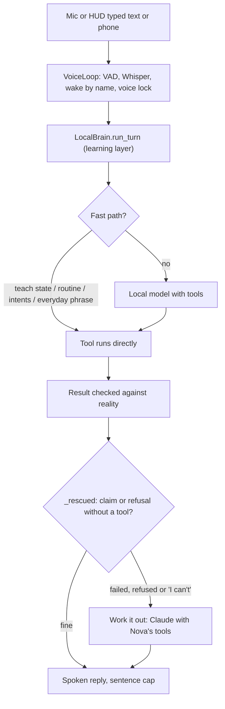

# Request flow

What happens when you say "Nova, open a new tab".

1. **Hearing** ([[Voice pipeline]]): Silero VAD finds the end of speech, Whisper transcribes, the name check decides if it's for Nova, and the [[Voice lock]] checks it's Oliver.
2. **Learning layer** ([[Self-learning]]): corrections ("no, I meant Steam"), "when I say X, do Y", and replay of learned lessons.
3. **Special routes** in `local.py`: background-job phrases ([[Background jobs]]), replies to screen alerts ("fix it", "close it"; see [[Screen watch and windows]]), "work it out / use Claude to ..." ([[Work it out]]), "don't/stop" messages (never act), small talk.
4. **[[Fast path]]**: in order: teach → routines → `match_intent` (memory → watch → teach → voice/subtitles → timer → grid/numbers → video → keyboard → music → "play X") → everyday phrases. Compound "X and Y" is split when every part is known.
5. **Local model** with a short tool list ([[Local brain]]).
6. **`_rescued`** checks every sentence of the reply: an action claim with no tool run is held back; a refusal or a failed PC action goes to [[Work it out]].

Tools get a `ToolContext` whose `services` hold the live objects: brain, voice, scheduler, watchers, grid, subtitles, teacher, memory, spotify, screenwatch, voicelock.
